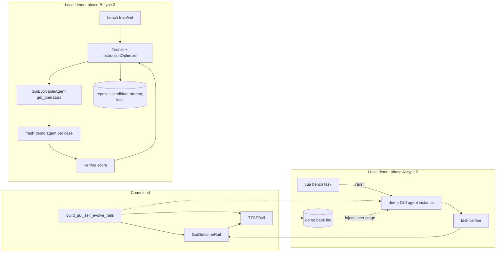

# GUI agent self-evolution (harness-based online + data-based offline)

## 1. Design position and how to read this

This proposal shows that the GUI subagents (`cua_agent`, `browser_agent`, `mobile_gui_agent`) can improve themselves without touching model weights. It uses the user's taxonomy:

- **Type 2, harness-based (online)**: the agent improves its own harness (learned facts/tips) from its own runs, inside the agent loop. Phase A.
- **Type 3, data-based (offline)**: a batch job takes a fixed task set and produces a better harness artifact (system prompt), accepted only on measured improvement. Phase B.
- Type 1 (model weights, `agent_rl/`) is out of scope.

The repo's agents are **not** optimised. A separate instance, built by a local demo script with its own bank and prompt files, does the learning, to show that the loop works. Only the small reusable piece (outcome bridge + rail builder) is committed. Implementation records go to a feature doc (none yet).

## 2. Background, goals and scope

### 2.1 Background

Verified on `feature/gui-self-evolve` (upstream/develop 02b2ce453 + 4 cua commits):

- All three GUI factories build a `DeepAgent` and accept caller rails: `create_cua_agent` (`subagents/cua_agent.py`), `create_browser_agent` (`subagents/browser_agent.py:420`), `create_mobile_gui_agent` (`subagents/mobile_gui_agent.py:112`). Each does `final_rails = list(rails or []) + injected_rails`. None attaches an evolution rail.
- Each agent already produces run-outcome evidence that is thrown away after the run: cua `result["cua_result"]` (`CuaProgressRail`), browser `authoritative_browser_result` (`BrowserRuntimeRail`), and mobile rails from `build_mobile_gui_rails`.
- CUA app quirks (UWP apps ignore hotkeys, `type_text` via ax replaces the buffer, Lark toolbar has no accessible names) have been learned by hand.
- `examples/cua/cua_bench.py` (local, not committed) has 5 Windows tasks with code-verified outcomes. It is the only ground-truth grader available; browser and mobile have none in the repo.
- Reusable machinery:
  - `TTSERail` (`harness/rails/evolution/ttse_rail.py`): FACT/TIP induction after a run, injection in `before_model_call`, auto-dream consolidation; `TTSEConfig.store_path`, `inject_enabled`, `evolve_enabled`, `traj_char_budget`. The bank has no row cap upstream (F_20261031_1022).
  - `SignalBasedSuccessDetector` reads an external `ttse_score` first (snapshot, `ctx.ttse_score`, or `ctx.inputs.ttse_score`; `agent_evolving/ttse/success.py`).
  - `Trainer` needs an agent with `get_operators()`; `DeepAgent` has none. `LLMCallOperator` wraps a system prompt with an `on_parameter_updated` callback; `InstructionOptimizer` proposes prompt changes.

### 2.2 Goals and key scenarios

| Scenario | Current | Target |
| --- | --- | --- |
| Any GUI factory called as today | — | Unchanged: same rails and prompt (no new factory parameter) |
| Demo instance, learn-only, runs bench tasks | Nothing learned | Bank file fills with FACT/TIP rules induced from verifier-scored runs; nothing is injected |
| Demo instance, injection on (later stage) | — | The warm bank's rules appear in the prompt; cold-bank vs warm-bank pass rates are reported |
| A run with no verifier | — | TTSE's default detector decides success; run result unchanged |
| Production GUI agent with a bank attached, `inject_enabled=True` | — | The bank's rules are injected into the production agent's prompt (opt-in via the builder); the agent is otherwise unchanged |
| Offline demo (phase B) | Not possible | Trainer proposes prompts for the demo instance; the report shows which candidates passed or failed the validation gate. The repo prompt is untouched |

### 2.3 Scope and non-goals

- Committed: `GuiOutcomeRail`, `build_gui_self_evolve_rails`, unit tests, a usage doc covering demo and production use (injection in production is a goal, opt-in through the builder).
- Local only (not committed): the demo scripts (`examples/cua/` bench hook for phase A, `cua_prompt_evolve.py` for phase B), their bank and prompt files.
- Not in scope: changing factory signatures or defaults; optimising the repo's shipped prompts; changing TTSE/Trainer algorithms; letting evolution touch tools, permission rules or rails; sharing banks; browser/mobile benches (they get unit coverage only); weight training.

## 3. Constraints, assumptions and open questions

- Constraints:
  - The repo agents stay unoptimised and byte-identical when the builder is not used.
  - Scores come from code verifiers whenever one exists (user rule 5: deterministic before model).
  - Learned content is prompt advice only; it can never widen permissions (GUI actions have real side effects).
  - Rollout order is fixed by the user: learn-only first (`inject_enabled=False`), then injection, including in production.
  - Production injection is opt-in: the shipped factories still do not attach the builder by default.
- Assumptions (to verify in development):
  - A-1: Rails run their `after_invoke` callbacks in list order when priorities are equal, or `callback_priority` can force `GuiOutcomeRail` before `TTSERail`. Fallback: put the score on `ctx.inputs.ttse_score`, which `success.py` already reads.
  - A-2: TTSE's deterministic `execution_failure` rules recognise each agent's tool-failure text (CUA driver marker, browser/mobile errors). If not, only the builder's config adapts; TTSE code is not edited.
  - A-3: Screenshots (cua multimodal, mobile, browser) do not reach the induction prompt as base64. `trajectory/messages.py` has no image handling. Mitigation: a default `traj_char_budget` from the builder, plus stripping image parts in the bridge's snapshot if needed.
  - A-4: TTSE evolution in `after_invoke` finishes, or can be awaited (`flush()`), before bench teardown.
- Open questions:
  - Q-1 (answered 2026-11-23): the cua bench demo is enough to show it works for the GUI family.
  - Q-2 (answered 2026-11-23): injection is wanted in production as well.
  - Q-3 (answered 2026-11-23): production keeps learning while it injects, but only into the agent instance's own local storage. A running agent never writes learned content into the agent-core `openjiuwen/` package or the repo checkout.

## 4. Overall design and trade-offs

### 4.1 Overview

Arrows show data flow. Dashed arrows are wiring or the later injection stage.

### 4.2 Key decisions

#### D-01 Attach through `rails=`; no new factory parameter

- Choice: `build_gui_self_evolve_rails(config) -> list[AgentRail]` returns `[GuiOutcomeRail, TTSERail]`. The caller (demo) passes them via each factory's existing `rails=`.
- Why: the user does not want the repo agent optimised. Leaving the factories alone keeps the default path identical, and one builder covers all three GUI agents.
- Cost: callers wire it themselves. There is no single switch on the agent.
- Candidate: R-03.

#### D-02 Reuse TTSE for type 2

- Choice: TTSE's FACT track matches app/site quirks, TIP matches procedures, and dream handles dedup and pruning.
- Cost: TTSE prompts are tuned for text/coding trajectories, so induction quality on long GUI tool loops is unproven. The demo measures it (V-04).
- Candidate: R-01.

#### D-03 Verifier score beats heuristics

- Choice: `GuiOutcomeRail(verifier)` awaits an optional `verifier(result) -> Optional[float]` and sets `ttse_score`. Agent heuristics (`cua_result.status`, browser status) are **not** turned into scores. `CuaProgressRail`'s own docstring says its status is not a completion judgment.
- Cost: without a verifier, TTSE's LLM judge and deterministic failure rules decide.
- Candidate: R-02.

#### D-04 Phase B is a demo of the loop, not a shipped prompt

- Choice: phase B runs locally on the demo instance through a `GuiEvolvableAgent` adapter (one `LLMCallOperator`, a fresh agent per case). It writes a report and candidate prompt files and applies nothing to the repo.
- Gate: a candidate is "accepted" only if its mean pass rate over N=3 repeats on the held-out tasks beats the baseline by at least one task-equivalent.
- Cost: with a 5-task bench, an accepted candidate shows only that the loop works, not that it generalises. The report says so.

#### D-05 Safety boundary

- Evolution writes only to the demo bank file and local prompt/report files. Permission rules, tool lists and agent rails are built independently of learned content.

### 4.3 Rejected alternatives

| Candidate | Difference | Why not | Revisit when |
| --- | --- | --- | --- |
| R-01 / D-02: SkillEvolutionRail | Learns whole skill bodies, with approval | Heavier; GUI failures are mostly one-line app/site facts | TIP track proves too shallow for multi-step procedures |
| R-02 / D-03: score from agent status | Score without a verifier | Heuristic status would teach wrong lessons | An agent's status becomes authoritative |
| R-03 / D-01: `self_evolve=` on each factory | One switch per agent | Changes three public signatures; the builder already gives production an opt-in without them | Callers find manual wiring error-prone |
| Agent edits its own rails/code | Literal recursive self-improvement | Ungrounded and unsafe for real GUI control | Not planned |

## 5. Detailed design

### 5.1 Responsibilities and invariants

- I-1: Factories without the builder produce the same rails and prompt as today (V-01).
- I-2: `GuiOutcomeRail` only sets `ttse_score` (and `ttse_task_query` if given). It never changes the result returned to the caller (V-02).
- I-3: Learned content never changes permission rules or the tool set (V-05).
- I-4: The builder never falls back to a default bank path. `store_path` is required, because TTSE's default `.ttse/bank.json` is relative to the working directory and would land in the repo when run from its root. The builder resolves the path and refuses one inside the installed `openjiuwen` package (V-09). Each agent instance learns into, and injects from, only its own bank.

### 5.2 Key classes and functions

| Symbol | Change | Responsibility |
| --- | --- | --- |
| `harness.rails.evolution.gui_self_evolve.GuiOutcomeRail` | new, public | `__init__(verifier: Optional[Callable[[dict], Awaitable[Optional[float]]]] = None)`; `async after_invoke(ctx)` sets the score ahead of TTSE (A-1). The verifier gets the invoke result dict. |
| `harness.rails.evolution.gui_self_evolve.GuiSelfEvolveConfig` | new frozen dataclass | `llm`, `model`, `store_path` (required), `inject_enabled=False`, `evolve_enabled=True`, `verifier=None`, `ttse_config: Optional[TTSEConfig]=None` |
| `harness.rails.evolution.gui_self_evolve.build_gui_self_evolve_rails(config) -> list[AgentRail]` | new, public | Builds `[GuiOutcomeRail, TTSERail]` with GUI defaults (`traj_char_budget`, image stripping per A-3) |
| `harness.rails.evolution.__init__` | modified | Exports the three symbols |
| `examples/cua/cua_bench.py` | modified, local | `--self-evolve [--inject]`; passes each task's verifier; reports bank rule count and rules learned per run |
| `examples/cua/cua_prompt_evolve.py` + `GuiEvolvableAgent` | new, local | Phase B demo loop and report |

### 5.3 Flow (phase A demo run)

1. The demo builds `create_cua_agent(..., rails=build_gui_self_evolve_rails(cfg))` with `store_path` under the demo folder and the task's verifier.
2. The run executes. In learn-only mode, nothing is injected.
3. In `after_invoke`, the agent's own rails write their outcome, `GuiOutcomeRail` awaits the verifier and sets `ttse_score`, and `TTSERail` detects success and induces rules into the bank.
4. The bench tears down after evolution finishes (A-4).

### 5.4 Failures

- The verifier raises an exception or times out: a warning is logged, no score is set, and the default detector decides. The run result is unaffected.
- Induction fails: TTSE's existing policy applies. The run result is unaffected.
- The bank cannot be written: TTSE's behaviour applies (V-06).

## 6. Impact and implementation order

| Item | Files | Change | Verified by |
| --- | --- | --- | --- |
| I-01 | `harness/rails/evolution/gui_self_evolve.py`, `__init__.py` | Rail, config, builder | V-01, V-02, V-03, V-05 |
| I-02 | same module (only if A-2/A-3 fail) | Failure-text config, image stripping | V-06 |
| I-03 | `tests/unit_tests/harness/rails/evolution/test_gui_self_evolve.py` | Unit tests for all three factories | V-01 to V-06 |
| I-04 | user docs (harness rails page) | Short usage section | — |
| I-05 | `examples/cua/cua_bench.py` (local) | Phase A demo hook | V-04 |
| I-06 | `examples/cua/cua_prompt_evolve.py` (local) | Phase B demo | V-07 |

Commits for I-01 to I-04 split as feat / test / docs. I-05 and I-06 are not committed.

## 7. Compatibility

Purely additive: new module and exports, no signature changes. Rollback means removing the module. Demo banks are local files and safe to delete.

## 8. Verification

| ID | Scenario | How | Pass condition | Level |
| --- | --- | --- | --- | --- |
| V-01 | No builder | Build each of the three GUI agents with and without the builder's rails | Without: identical to today. With: only the two extra rails added | unit |
| V-02 | Verifier returns 1.0 / 0.0 | Fake verifier, capture what the detector receives | Detector gets that score; caller result unchanged | unit |
| V-03 | Verifier raises / returns None | Same setup | No score; run completes; warning logged | unit |
| V-04 | Phase A demo | cua bench, 5 tasks × 3 repeats: stage 1 learn-only (bank inspected by hand); stage 2 injection, cold vs warm | Stage 1: rules are correct app facts, and wrong ones are listed in the report. Stage 2: warm ≥ cold, no task drops by more than 1/3 | live, Windows, real LLM key |
| V-05 | Learned content cannot widen permissions | Seed the bank with a rule pushing a denied tool / kill_app | Permission engine still denies; tool list unchanged | unit |
| V-06 | Screenshots in trajectories | Capture induction input with screenshot mode on | No base64 image data; size ≤ budget | unit |
| V-08 | Production learn + inject | Builder with `evolve_enabled=True`, `inject_enabled=True`, a tmp bank | Rules are induced into, and injected from, that bank only; nothing under the repo or package changes | unit |
| V-09 | Bank path guard | `store_path` missing, or inside the `openjiuwen` package | Builder raises a clear error; no file is created | unit |
| V-07 | Phase B demo gate | Trainer on train split, validate N=3 | Report shows each candidate's scores and gate decision; the repo prompt is untouched | live, local |

## 9. Risks and known limits

| Risk | Impact | Mitigation | Check |
| --- | --- | --- | --- |
| TTSE induces wrong facts from noisy runs | Demo instance gets worse | Verifier-gated scores; learn-only stage first; dream pruning | V-04 stage 1 review |
| 5-task bench | Phase B "acceptance" does not generalise | Report states the demo-only claim | V-07 report wording |
| Desktop non-determinism | False accept/reject | N=3 repeats, margin rule | V-04, V-07 |
| Wrong rules reach production prompts | A production GUI agent acts on bad advice | Each instance's bank is local to it, so damage stays in one instance; the bank file can be inspected or deleted; `inject_enabled` / `evolve_enabled` switch off per instance | V-08 |
| Live runs need a valid OpenRouter key | Demo cannot run | Check the key with one cheap call before the bench | before V-04 |

Known limit: browser and mobile get unit coverage only. Only the cua bench has a ground-truth verifier.

## 10. Review and revision log

| Date | Reviewer | Topic | Result | Change |
| --- | --- | --- | --- | --- |
| 2026-11-23 | — | Initial draft (cua only) | Superseded the same day | — |
| 2026-11-23 | kwangyyinc (chat answers) | Scope | Answers recorded; design not yet approved | All GUI agents in scope; phase B not committed; repo agent not optimised, a separate instance demonstrates it; learn-only first, injection later. Factory parameter replaced by a rails= builder (D-01); bench expansion dropped |
| 2026-11-23 | kwangyyinc (chat answers) | Q-1, Q-2 | Answered | cua demo is enough; production injection wanted. Added production scenario, Q-3 (production learning vs read-only bank), V-08, production risk row |
| 2026-11-23 | kwangyyinc (chat answer) | Q-3 | Answered | Production learns and injects, local to each agent instance only; never writes into openjiuwen/. Added the path guard (I-4, V-09) and rewrote V-08 and the production risk row |
| 2026-11-23 | kwangyyinc | Approval | Approved ("okay, let's do it") | Moved to active; development starts |

## 11. References and handoff

- Related: F_21_cua-desktop-subagent; F_20261103_1510_cua-agent-log-file; F_20261031_1022_ttse-unbounded-bank; `agent_evolving/AGENTS.md`.
- Handoff to development (after approval): I-01 to I-05 first (phase A), then I-06.
- Implementation record: none yet.
